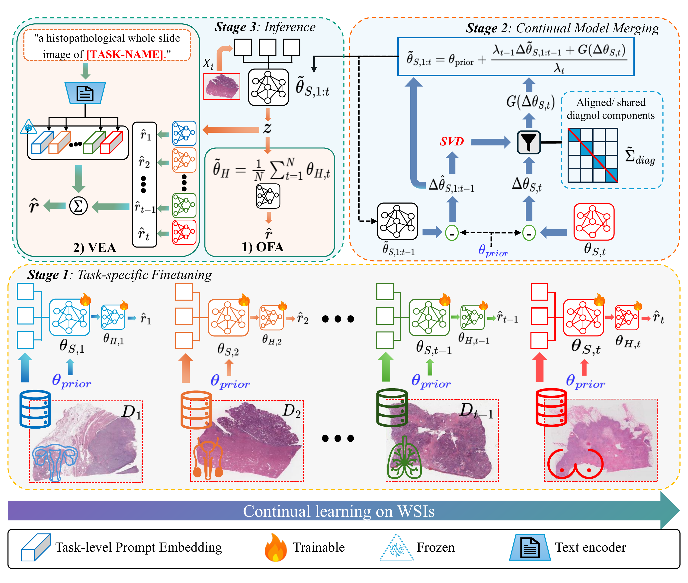

# [MMM 2027] MergeSurv: Merging-Based Continual Learning for Survival Analysis on Whole-Slide Images

## Overview

This repository provides the official implementation of **MergeSurv**, a merging-based continual learning framework for whole-slide image (WSI) survival analysis.



## Environment

```bash
conda create -n mergesurv python=3.10 -y
conda activate mergesurv
pip install -r requirements.txt
```

**Pretrained model:** We use the pretrained [TITAN model from MahmoodLab](https://huggingface.co/MahmoodLab/TITAN).


## Running Experiments
### Configurations

- `configs/forward.yaml`: BLCA → UCEC → LUAD → BRCA.
- `configs/reverse.yaml`: BRCA → LUAD → UCEC → BLCA.
- `configs/other.yaml`: LUAD → BLCA → UCEC → BRCA.

### Training

Fine-tune the TITAN WSI aggregator and Cox head independently for each task:

```bash
python -m training.finetune --config configs/forward.yaml
```

### Model Merging

**One-for-All (OFA):**

```bash
python -m merging.ofa --config configs/forward.yaml
```

**Voting-Expert Aggregation (VEA):**

```bash
python -m merging.vea --config configs/forward.yaml
```

### Evaluation

**OFA:**

```bash
python -m evaluation.ofa --config configs/forward.yaml
```

**VEA:**

```bash
python -m evaluation.vea --config configs/forward.yaml
```

### Continual Learning Baselines

The repository also includes Joint Training, Naive Fine-Tuning, EWC, LwF, ER, DER, and DER++.

```bash
# Joint training and naive fine-tuning
python -m baselines.train_joint --config configs/forward.yaml
python -m baselines.train_naive --config configs/forward.yaml

# Continual learning baseline (example: EWC)
python -m baselines.train_continual --config configs/forward.yaml --method ewc
```

To evaluate the baselines:

```bash
python -m evaluation.joint --config configs/forward.yaml
python -m evaluation.naive --config configs/forward.yaml
python -m evaluation.continual --config configs/forward.yaml --method ewc
```

Other continual learning methods can be selected with `--method`: `ewc`, `lwf`, `er`, `der`, or `derpp`.

## Citation

If you find this repository useful, please cite our paper:

```bibtex
@inproceedings{tran2027mergesurv,
  title     = {MergeSurv: Merging-Based Continual Learning for Survival Analysis on Whole-Slide Images},
  author    = {Tran, Vu Minh and Bui, Doanh C. and Pham, Van-Hau and Nguyen, Khang},
  booktitle = {Proceedings of the 33rd International Conference on Multimedia Modeling (MMM 2027)},
  publisher = {Springer},
  series    = {Lecture Notes in Computer Science},
  year      = {2027},
}
```